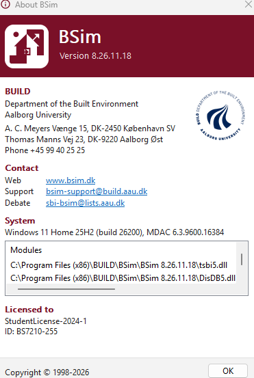

<link rel="stylesheet" href="../style.css">

# Om BSim

<figure id="center_img">

<figcaption>Dialogen vises ved klik på Help | About BSim.</figcaption>
</figure>

Dialogen indeholder en række informationer, hvoraf nogle er afhængige af den aktuelle installation.

* Øverst, til højre for ikonet, vises den aktuelt kørende version af BSim. Versionsnummeret, her 8.26.11.18, refererer direkte til den dato, hvor nærværende opdatering er genereret, og skal læses som: BSim version 8, år 2026, den 18. november. Det er muligt at kontrollere, om den seneste version er installeret ved at besøge BSims hjemmeside på www.bsim.dk.

* Umiddelbart under findes et felt med informationer om BUILD, Department of the Built Environment ved Aalborg Universitet, herunder kontaktoplysninger.

* Under afsnittet *Contact* vises links til BSims hjemmeside, supportmail og debatforum.

* Under afsnittet *System* vises information om det benyttede operativsystem samt versionen af MDAC. Der skal være installeret en kompatibel version af MDAC for at kunne afvikle BSim korrekt.

* Midt i dialogen findes en liste med de installerede BSim-moduler samt den fulde sti til de tilhørende filer. Hvis der højreklikkes på et modul, vises versionsnummeret.

* Under afsnittet *Licensed to* findes information om installationens licens, herunder firmanavn eller licensindehaver samt licensnummer.

* Nederst i dialogen vises copyright-information for den aktuelle BSim-version.