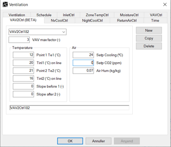
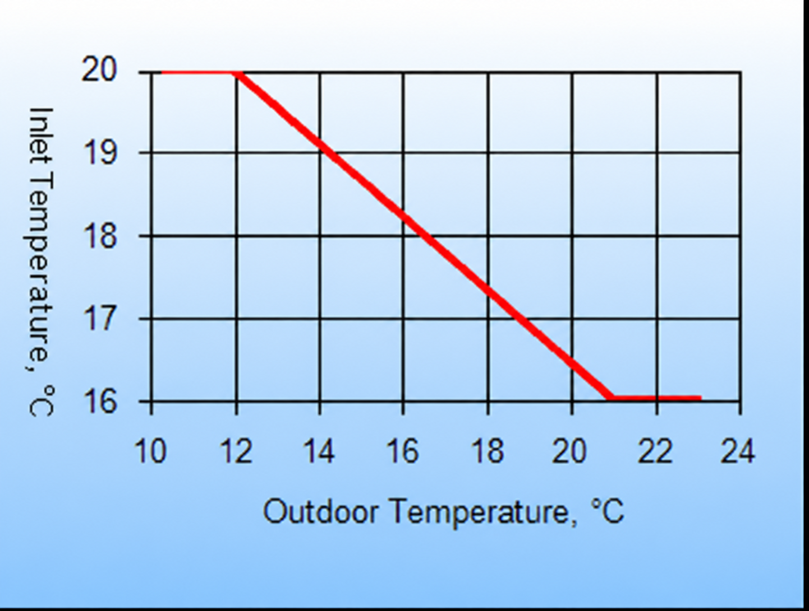

<link rel="stylesheet" href="../style.css">

# Ventilation, VAV2-regulering

VAV2-regulering (Variable Air Volume) er en anden form for VAV-regulering der styrer indblæsningstemperaturen efter udetemperaturen (udekompensering). 

<figure id="center_img">

<figcaption>Definition (Ventilation | VAV2Ctrl) af reguleringsstrategien for VAV2-regulering.</figcaption>
</figure>

Funktionen fungerer således, at ved lave udetemperaturer, hvor varmebehovet i rummet er størst, indblæses med maksimumtemperaturen, *Tinl1*. Når udetemperaturen når værdien indtastet i *Point 1 Te 1 (°C)* indblæses med lavere temperaturer, som følger en lineær kurve, indtil minimumstemperaturen, *Tinl2*, som opnås når udetemperaturen når *Point 2 Te 2 (°C)*. Ved fortsat stigende kølebehov vil regulatoren åbne for kølefladen, når setpunktet, *Setp Cooling (°C)*, for køling overskrides.

<figure id="center_img">

<figcaption></figcaption>
</figure>

*VAV, max factor*: Volumenstrømmen (nominel) angivet ved data for 'ventilator' kan blive forøget med faktoren angivet i parameteren *VAV max factor* (≥ 1). Faktoren vil normalt ligge i intervallet 1,0 - 3,0.

*Point 1 Te 1 (°C)*: Ved denne udetemperatur sænkes indblæsningstemperatur lineært mod minimumindblæsningstemperaturen.

*Tinl1:* Maksimumindblæsningstemperaturen som benyttes ved udetemperaturer lavere end værdien indtastet i *Point 1 Te 1 (°C)*.

*Point 2 Te 2 (°C):* Ved denne udetemperatur indblæses med minimumstemperaturen indtastet i *Tinl2*.

*Tinl2*: Minimumsindblæsningstemperaturen som benyttes ved udetemperaturer højere end værdien indtastet i *Point 2 Te 2 (°C)*.

*Setp Cooling*: Ved kølebehov øges luftmængden gradvist for at holde setpunktet. Såfremt dette ikke er tilstrækkeligt, åbnes der gradvist for kølefladen, indtil enten den maksimale køleydelse nås, eller indblæsningstemperaturen kommer ned på minimumværdien. 

*Setp. CO2*: Angiver setpunktet for VAV2-regulering for opnåelse af ønsket CO2 indhold i indeluften. Regulering efter CO2 indholdet har prioritet i forhold til indetemperatur, dvs. der reguleres først efter opnåelse af det ønskede CO2 indhold og dernæst efter den ønskede indetemperatur. Hvis der ikke ønskes regulering efter CO2 indholdet indtastes 0 som *Setp. CO2*. 

- CO2-indholdet i udeluften angives som en information på bygningens [Site](../24Miscellaneous/24_25_Site_Property.md).

*Air Hum*: Angiver det ønskede absolutte fugtindhold i indblæsningsluften. Denne parameter har kun betydning, såfremt der er defineret en befugter i anlægget. Der vil således ikke foregå en affugtning i denne reguleringstype.