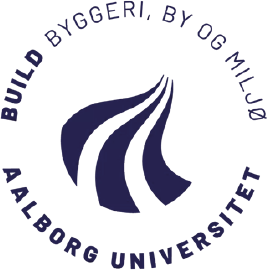

<!-- The front page is HTML throughout: markdown inside an HTML block is not
     parsed by HonKit, so headings and emphasis would show as plain text.
     Layout: .frontpage in shared.css. Banner: make_frontpage.py. -->

<h1>BSim Brugervejledning</h1>

<strong>Brugervejledning</strong> 
Kim B. Wittchen, Kjeld Johnsen, Karl Grau, Jørgen Rose &amp; Rasmus L. Jensen

<strong>Programudvikling</strong> 
Karl Grau Sørensen, Kjeld Johnsen, Carsten Rode, Kim B. Wittchen, Rasmus L. Jensen, Christian Grau Sørensen, Peter Scheutz &amp; Mikkel H. Lauridsen

<em>BSim (Building Simulation) er et integreret edb-værktøj til projektering af bygninger og installationer.</em>

<em>Copyright © Statens Byggeforskningsinstitut (SBi), 1999-2019; Institut for Byggeri, By og Miljø (BUILD), Aalborg Universitet, 2020-2026</em>

