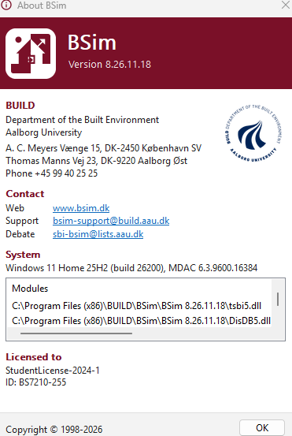

<link rel="stylesheet" href="../style.css">

# About BSim

<figure id="center_img">

<figcaption>The dialog is displayed by selecting Help | About BSim.</figcaption>
</figure>

The dialog contains a range of information, some of which depends on the current installation.

* At the top, to the right of the icon, the currently running version of BSim is displayed. The version number, here 8.26.11.18, refers directly to the date on which the current update was generated and should be interpreted as: BSim version 8, year 2026, November 18. It is possible to check whether the latest version is installed by visiting the BSim website at www.bsim.dk.

* Immediately below is an information section containing details about BUILD, Department of the Built Environment at Aalborg University, including contact information.

* The *Contact* section contains links to the BSim website, support email, and discussion forum.

* The *System* section displays information about the operating system in use as well as the installed version of MDAC. A compatible version of MDAC must be installed in order for BSim to operate correctly.

* In the middle of the dialog, a list of the installed BSim modules is displayed together with the full path to the associated files. Right-clicking a module displays its version number.

* The *Licensed to* section contains information about the installation license, including the company name or license holder and the license number.

* At the bottom of the dialog, copyright information for the current BSim version is displayed.