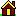

<link rel="stylesheet" href="../style.css">

**# SimView - Toolbar**
<figure id="image_linewidth">

<figcaption>Toolbar in BSim.</figcaption>
</figure>

The toolbar in **BSim** contains a number of buttons with the following functions (from left to right):

|  | [Create new project (shortcut: **Ctrl + N**)](../09SimView/09_12_Model_wizard_creating_a_new_model.md) |
|---|:---|
|  | Open existing project (shortcut: **Ctrl + O**). In the open dialog box, models (from version 1.1.12.12) are shown with a coloured icon  and backup-models with a grey icon . |
|  | Save current project (shortcut: **Ctrl + S**) |
|  | Expand tree summary from current level down |
|  | Collapse tree summary from current level down |
|  | Undo last action (shortcut: **Ctrl + Z**) |
|  | Redo the last undo |
|  | Cut (shortcut: **Ctrl + X**) |
|  | Copy (shortcut: **Ctrl + C**) |
|  | Paste (shortcut: **Ctrl + V**) |
|  | [Calculation of daylight with **SimLight**](../15SimLight_Daylight_calculations/15_01_Daylight_calculations_with_SimLight.md) |
|  | [Switch to **SimView**](../09SimView/09_01_SimView.md) |
|  | [Switch to **XSun**](../14XSun_Analysis_of_incident_solar_radiation/14_01_Analysis_of_incident_solar_radiation_with_XSun.md) |
|  | [Switch to **tsbi5**](../13tsbi5_thermal_simulation/13_04_tsbi5_simulation.md) |
|  | Start plug-in application 1, in this case [**SimDXF**](../24Miscellaneous/24_47_About_SimDXF.md) (install via **Application** | **Setup**) |
|  | Start plug-in application 2, in this case **Notepad** (install via **Application** | **Setup**) |
|  | [Start **SimDB**](../24Miscellaneous/24_42_About_SimDB.md) |
|  | Update view |
|  | Zoom in (shortcut: "+") |
|  | Zoom out (shortcut: "-") |
|  | Expand bounding box by 20 % in all directions to show a larger area around the model |
|  | Collapse bounding box by 20 % in all directions to show a smaller area around the model |
|  | Move viewpoint (rotate the model) to the left (shortcut: "left arrow") |
|  | Move viewpoint down (view the model more from above) (shortcut: "up arrow") |
|  | Move viewpoint up (view the model more from below) (shortcut: "down arrow") |
|  | Move viewpoint (rotate the model) to the right (shortcut: "right arrow") |
|  | Shows the **About BSim** dialog |
|  | Clean the model of redundant geometry |
|  | Export the model to Radiance |

 

The following functions had dedicated buttons in the toolbar in the classic version of BSim. In the current version, the functions are still available, but are accessed via the menus in the upper-left corner of the program window.

|  | Print preview |
|---|:---|
|  | Print (shortcut: **Ctrl + P**) |
|  | Show the model using the standard internet browser in [model DOC](../24Miscellaneous/24_29_Model_DOC.md) format |
|  | Show listing (documentation) for current view, [**ModelList**](../06BSim_Program_structure/06_07_SimView_Printing_a_model.md) |
|  | Convert the building model to be used in the Danish building code energy frame compliance checker, Be18 (available in English and using customized weather data) |

 

 Select the **View/ModelList** menu option or click the corresponding icon. This will open a window in which the model's data is displayed line by line. Each line starts with an icon indicating the type of information. As long as this window is displayed, the model can be printed.

Related subjects:

* [Creating a new model](../09SimView/09_12_Model_wizard_creating_a_new_model.md)
* [Toolbar](../06BSim_Program_structure/06_05_SimView_Toolbar.md)
* [Creating a building](../09SimView/09_14_SimView_Creating_a_building.md)
* [Creating a space](../09SimView/09_15_SimView_Creating_a_space.md)
* [Default constructions](../24Miscellaneous/24_28_Insert_Default_Options.md)
* [Creating thermal zones](../10Thermal_zones/10_01_Thermal_Zone_property.md)
* [Adding spaces to thermal zones](../10Thermal_zones/10_02_SimView_Adding_spaces_to_thermal_zones.md)
* [Adding systems to thermal zones](../11Systems/11_01_Systems.md)
* [Editing the model geometry](../09SimView/09_02_SimView_Editing_the_model_geometry.md)
* [Adding an opening or WinDoor](../09SimView/09_07_Windoor_property.md)
* [Virtual zones](../09SimView/09_05_Sim_View_Virtual_zones.md)
* [Climate data and ground](../09SimView/09_10_Climate_data.md)
* [Printing a model](../06BSim_Program_structure/06_07_SimView_Printing_a_model.md)

See also:

* [SimView menu](../06BSim_Program_structure/06_06_SimView_Menu.md)