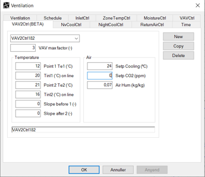
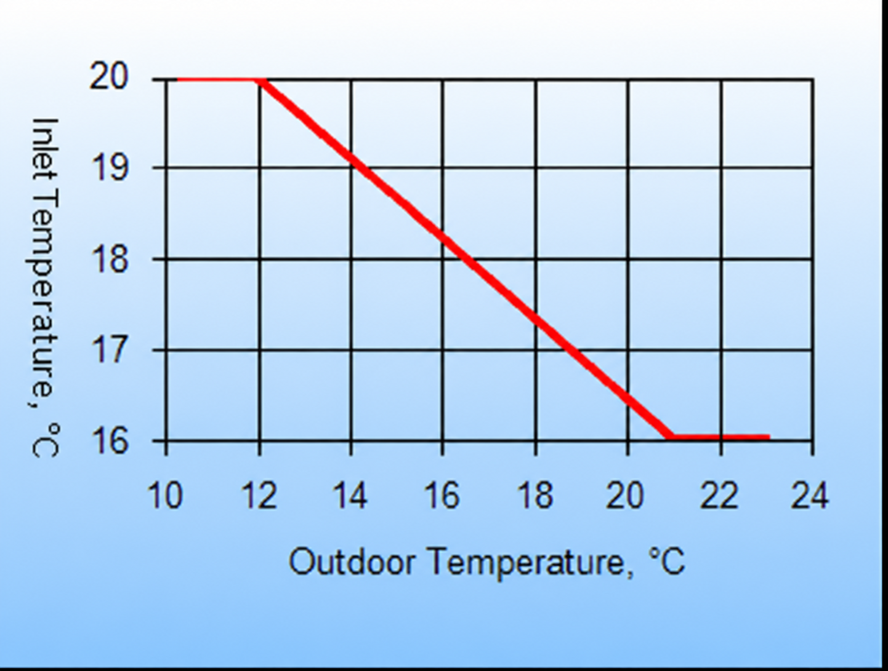

<link rel="stylesheet" href="../style.css">

# Ventilation, VAV2 control

VAV2 control (Variable Air Volume) is another form of VAV control that regulates the supply air temperature according to the outdoor temperature (outdoor compensation).

<figure id="center_img">

<figcaption>Definition (Ventilation | VAV2Ctrl) of the control strategy for VAV2 control.</figcaption>
</figure>

The function works as follows: at low outdoor temperatures, when the heat demand in the room is greatest, air is supplied at the maximum temperature, *Tinl1*. When the outdoor temperature reaches the value entered in *Point 1 Te 1 (°C)*, the air is supplied at lower temperatures, following a linear curve, until the minimum temperature, *Tinl2*, is reached when the outdoor temperature reaches *Point 2 Te 2 (°C)*. With continued increasing cooling demand, the controller will open the cooling coil when the setpoint, *Setp Cooling (°C)*, for cooling is exceeded.

<figure id="center_img">

<figcaption></figcaption>
</figure>

*VAV, max factor*: The airflow rate (nominal) specified by the data for the 'fan' can be increased by the factor specified in the parameter *VAV max factor* (≥ 1). The factor will normally lie in the range 1.0 - 3.0.

*Point 1 Te 1 (°C)*: At this outdoor temperature, the supply air temperature is reduced linearly towards the minimum supply air temperature.

*Tinl1:* The maximum supply air temperature used at outdoor temperatures lower than the value entered in *Point 1 Te 1 (°C)*.

*Point 2 Te 2 (°C):* At this outdoor temperature, air is supplied at the minimum temperature entered in *Tinl2*.

*Tinl2*: The minimum supply air temperature used at outdoor temperatures higher than the value entered in *Point 2 Te 2 (°C)*.

*Setp Cooling*: When there is a cooling demand, the airflow is gradually increased to maintain the setpoint. If this is not sufficient, the cooling coil is gradually opened until either the maximum cooling output is reached, or the supply air temperature drops to the minimum value.

*Setp. CO2*: Specifies the setpoint for VAV2 control to achieve the desired CO2 content in the indoor air. Control based on the CO2 content has priority over the indoor temperature, i.e. control is first based on achieving the desired CO2 content and then on achieving the desired indoor temperature. If no control based on CO2 content is desired, enter 0 as *Setp. CO2*.

- The CO2 content of the outdoor air is specified as information on the building's [Site](../24Miscellaneous/24_25_Site_Property.md).

*Air Hum*: Specifies the desired absolute humidity of the supply air. This parameter is only relevant if a humidifier is defined in the system. Therefore, no dehumidification will occur in this control type.
